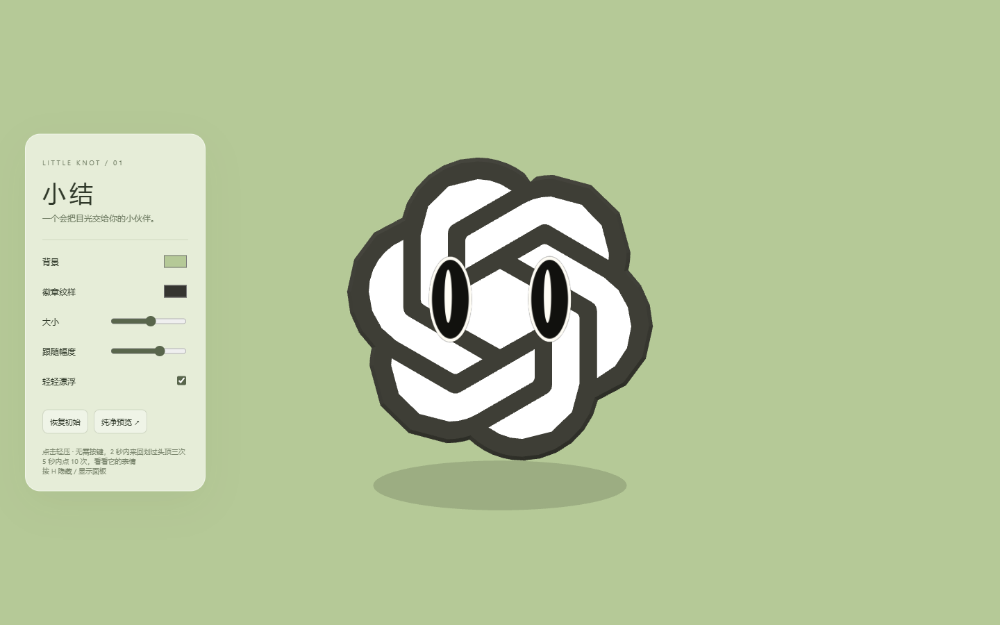
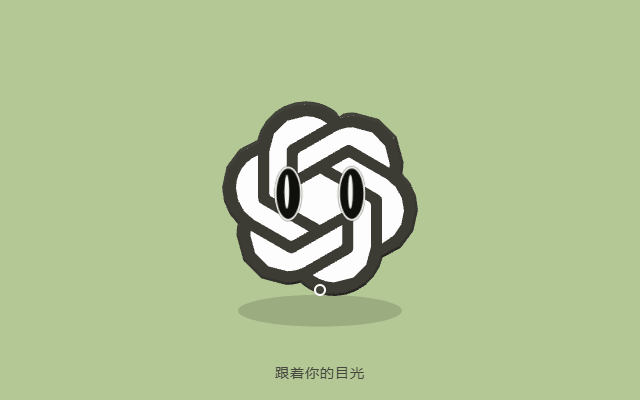
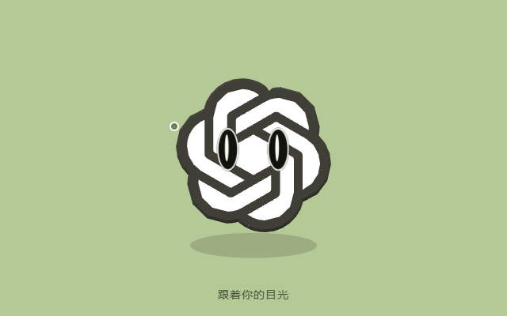
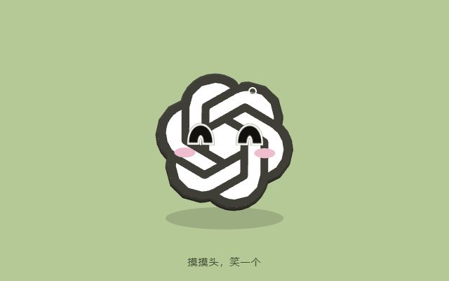
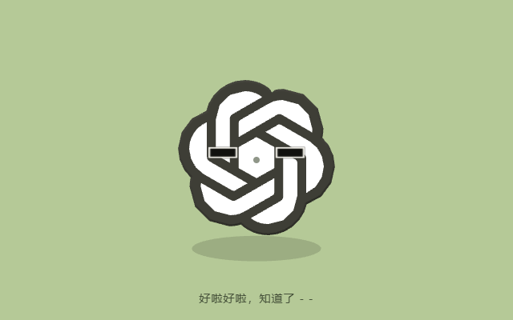

<div align="center">

# 小结 · Little Knot

**A tiny interactive 3D companion for Wallpaper Engine**

一个会看向你、会眨眼，也喜欢被摸摸头的小伙伴。

<p><code>Wallpaper Engine · Web</code> &nbsp; <code>Three.js</code> &nbsp; <code>Offline</code> &nbsp; <code>MIT (code)</code></p>



</div>

## Hello, Little Knot / 你好，小结

Little Knot is a lightweight interactive Web wallpaper built with Three.js. It follows the cursor, blinks, floats, and reacts to your attention. All runtime assets are bundled locally: no account, API key, or internet connection required.

小结是一款离线运行的 Wallpaper Engine 网页壁纸：它会随着你的鼠标转头、轻轻漂浮，偶尔眨眼，还会回应你的点击和抚摸。

<div align="center">


<sub>7.2-second looping demo · 鼠标追踪 → 点击回弹 → 摸摸头 → 十连点</sub>
</div>

## Little reactions / 小小的表情

<table>
<tr>
<td align="center"></td>
<td align="center"></td>
<td align="center"></td>
</tr>
<tr>
<td align="center"><b>Look / 看你</b></td>
<td align="center"><b>Pet / 摸摸头</b></td>
<td align="center"><b>Ten taps / 十连点</b></td>
</tr>
</table>

### Features / 互动方式

- **Follow your cursor / 视线跟随** — Move the mouse to turn the eyes and badge smoothly.
- **Blink & bounce / 眨眼与回弹** — Click the character to blink and gently squash.
- **Petting / 摸摸头** — Without holding a button, swipe left and right over the top-center of the head three times within 2 seconds. It smiles for 3 seconds, then has a 5-second cooldown.
- **Ten taps / 十连点** — Click the character ten times within 5 seconds to trigger a `- -` expression for 4 seconds.
- **Customize / 自定义** — Background and motif colors, character size, tracking strength, and gentle floating.
- **Lightweight / 轻量** — Offline Three.js and SVG assets; default 30 FPS, up to 60 FPS.

## Install in Wallpaper Engine / 安装

1. Download this repository (Code → Download ZIP) and extract it.
2. Open **Wallpaper Engine → Wallpaper Editor → Create Wallpaper**.
3. Select `wallpaper/index.html` to create a **Web wallpaper**.
4. Adjust color, size, mouse tracking, and floating under Wallpaper Engine properties.

**Important / 注意：** `wallpaper/` contains the complete offline runtime. Keep its `vendor/` files together. To update an installed wallpaper, do not overwrite its existing `project.json`, since it may contain settings and publication metadata.

## Preview & regenerate the GIF / 预览与重新生成动图

- Double-click `preview.html` to open the browser preview; press **H** to toggle the adjustment panel.
- To regenerate the demo, install Node.js, Playwright, Microsoft Edge, Python 3, and Pillow. Then run:

```bash
npm install --no-save playwright
python -m pip install Pillow
node scripts/demo.cjs
```

The script simulates mouse movement and interactions on the **actual wallpaper**, captures the frames, and exports `assets/little-knot-demo.gif` (640 × 400, 7.2 seconds, infinite loop). GIF-only captions and the cursor overlay do not change the wallpaper source. It also writes ignored verification artifacts into `checks/output/demo-frames/`.

## Build / 打包

```bash
python scripts/build.py
```

This creates a complete Wallpaper Engine import ZIP, a separate update ZIP that preserves installed `project.json`, and a SHA-256 manifest inside the ignored `dist/` directory.

Current feature baseline: **v18** (`version.json`). To prepare a new numbered version, use `python scripts/build.py --version 19` with your intended version number.

## Project structure / 项目目录

```text
wallpaper/                 Original offline Web wallpaper source
assets/                    README preview, looping GIF, and reaction images
preview.html               Browser preview shortcut
scripts/demo.cjs           Reproducible demo capture
scripts/encode-demo.py     Optimized GIF encoding with Pillow
scripts/build.py           Release packaging
version.json               Version source of truth
CHANGELOG.md               Release notes
LICENSE                    MIT license for original code
THIRD_PARTY_NOTICES.md     Attribution and trademark notes
```

Local backups, test captures, and generated release archives are deliberately excluded from the repository.

## Credits, licenses & trademarks / 来源与授权

- Original Little Knot application and interaction code: **MIT License**, © 2026 frycarrot. See [LICENSE](LICENSE).
- [Three.js r128](https://github.com/mrdoob/three.js) and SVGLoader: MIT, three.js authors. See [THREE-LICENSE.txt](wallpaper/vendor/THREE-LICENSE.txt).
- SVG path sourced from [Lobe Icons](https://github.com/lobehub/lobe-icons): MIT, LobeHub. See [LOBE-LICENSE.txt](wallpaper/vendor/LOBE-LICENSE.txt).
- Interaction inspiration: [Cat vs Ball of Wool](https://codepen.io/Yakudoo/pen/oXJYxy) by Karim Maaloul; no source from that project was copied.
- [Wallpaper Engine Web wallpaper documentation](https://docs.wallpaperengine.io/en/web/first/gettingstarted.html).

**Unofficial fan-made project.** Not affiliated with or endorsed by OpenAI or Wallpaper Engine. The OpenAI logo is a third-party brand mark, **not covered by this repository’s MIT license**. Third-party source licenses are not trademark permissions; please review [THIRD_PARTY_NOTICES.md](THIRD_PARTY_NOTICES.md) before redistributing branded artwork.

---

<div align="center"><sub>Little Knot · 一个会把目光交给你的小伙伴。</sub></div>
